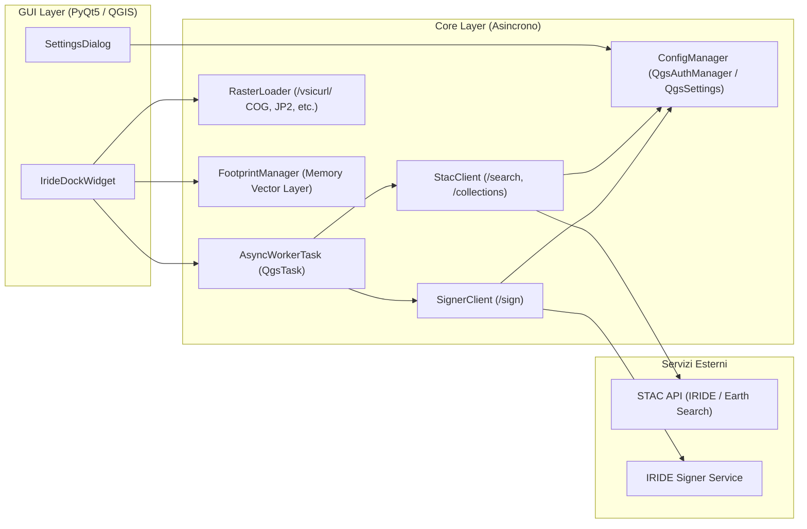

# Registro Tecnico & Note di Sviluppo (Uso Interno)

Questo documento raccoglie la specifica tecnica, l'architettura interna e il registro delle decisioni per lo sviluppo locale del plugin.

---

## 1. Architettura e Flusso Dati

---

## 2. Registro delle Decisioni Architetturali

- **Separazione Workspace vs Package Plugin (`2026-11-08`)**:
  - La root del repository ospita la documentazione (`README.md`), screenshot (`images/`), script (`scripts/`) e test (`tests/`).
  - Il plugin QGIS è isolato in `iride_stac_explorer/`.
- **Conformità Vincolante Disclaimer (`2026-11-08`)**:
  - Testo d'indipendenza centralizzato in `ConfigManager.OFFICIAL_DISCLAIMER` e presente in `metadata.txt` e nella GUI.
- **Asincronia Completa con Protezione GC (`2026-11-08`)**:
  - Introdotto `AsyncWorkerTask(QgsTask)` e coda `IrideDockWidget._active_tasks`.
- **Persistenza Sicura Multi-Livello (`2026-11-08`)**:
  - `QgsAuthManager` cifrato prioritario con fallback su `QgsSettings`.
- **Filtri Avanzati, Footprint Vettoriali e Quicklook (`2026-11-08`)**:
  - Filtro Collezione STAC, Copertura Nuvolosa Massima (`eo:cloud_cover`), memory layer vettoriale `IRIDE STAC Footprints`.
- **Transizione a Endpoint Reali e Rimozione Mock Offline (`2026-11-08`)**:
  - Modalità mock rimossa in favore del selettore esplicito: IRIDE Production vs Element84 Earth Search.
- **Internazionalizzazione Bilingue (IT/EN) (`2026-11-08`)**:
  - Modulo `core/i18n.py` con switch automatico in base alla lingua di QGIS.
- **Supporto Universale Formati Raster e `s3://` (`2026-11-08`)**:
  - Gestione di GeoTIFF COG, JPEG2000 `.jp2` e normalizzazione di `s3://` in HTTPS pubblico per `/vsicurl/`.
- **Preselezione Automatica Intelligente Asset (`2026-11-08`)**:
  - Sistema a punteggio gerarchico per preselezionare sempre il raster visualizzabile ed escludere i metadati XML/JSON.

