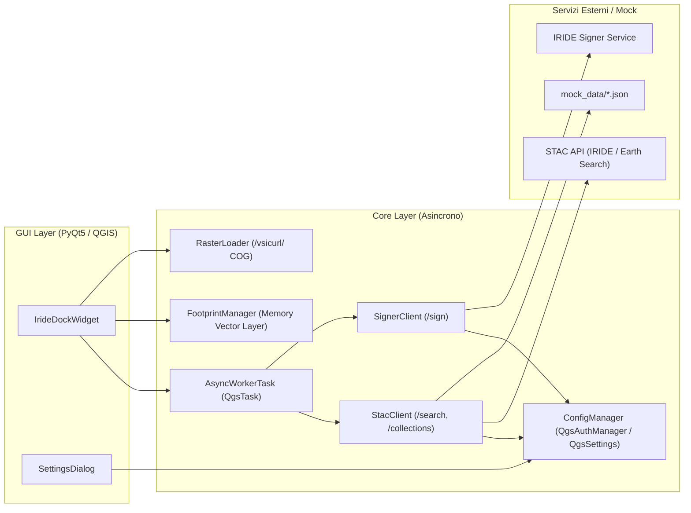

# Progetto: IRIDE STAC Explorer (QGIS Plugin)

Documento di specifica tecnica, architettura e implementazione per lo sviluppo del plugin in ambiente locale (Antigravity IDE / QGIS 3.44+).

---

## 1. Visione d'Insieme e Obiettivi

Sviluppare un'estensione autonoma e modulare per QGIS (Python 3.x / PyQt5) concepita per interrogare, filtrare e visualizzare a catalogo i prodotti satellitari della costellazione **IRIDE** erogati tramite specifiche standard OGC **STAC (SpatioTemporal Asset Catalog) API**.

### Principi Architetturali Chiave
1. **Piena Indipendenza:** Il plugin non rappresenta un client proprietario del Marketplace IRIDE, ma un ponte standard desktop conforme a STAC API 1.0.0.
2. **Nessun Blocco GUI (Asincronia Pura):** Tutte le operazioni di rete (interrogazioni catalogo `/search`, risoluzione degli endpoint `/collections`, firma temporanea degli asset `/sign`, download anteprime thumbnail) sono delegate a task worker asincroni in background (`QgsTask`).
3. **Zero Ingest Locale Forzato (Cloud Native Streaming):** I layer raster vengono caricati ed esplorati direttamente a schermo via protocollo `/vsicurl/` sfruttando la natura Cloud Optimized GeoTIFF (COG) degli asset, evitando il download integrale preventivo del dato grezzo su disco.
4. **Testabilità Indipendente da Credenziali:** Architettura predisposta con un commutatore per modalità *Mock Locale* e compatibilità nativa con cataloghi STAC aperti (es. Element84 Earth Search), per consentire lo sviluppo e il collaudo funzionale anche in assenza di API Key IRIDE attiva.
5. **Persistenza Sicura:** Memorizzazione dell'API Key e degli endpoint mediante le classi di configurazione native di QGIS (`QgsSettings` / `QgsAuthManager`).

---

## 2. Disclaimer Legale e Informativo Ufficiale

Questo testo è vincolante ed è inserito integralmente nel file `iride_stac_explorer/README.md`, nel manifesto `iride_stac_explorer/metadata.txt` (campo `about`) e all'interno della scheda informativa "About / Licenza" nella GUI del plugin:

```text
Important Notice & Disclaimer:
This plugin is an independent, third-party open-source project and is NOT officially affiliated with, endorsed by, maintained, or sponsored by the IRIDE programme, the European Space Agency (ESA), the Italian Space Agency (ASI), or the IRIDE Marketplace. Its sole purpose is to provide a desktop bridge to facilitate the discovery and visualization of data within QGIS.

Access to and use of IRIDE satellite data, products, and services are strictly governed by their respective terms of service, end-user licensing agreements (EULA), and usage policies established by the data providers and platform authorities. Users are solely responsible for obtaining their own valid API credentials, ensuring their compliance with applicable data quotas and access rights, and verifying that their data usage complies with all relevant legal and contractual frameworks.
```

---

## 3. Architettura e Flusso Dati



---

## 4. Organizzazione del Repository

La root del repository ospita la documentazione di progetto e gli strumenti di build/test, mentre l'intero codice del plugin QGIS risiede nella sottodirectory `iride_stac_explorer/`:

```text
qgis-iride-plugin/
├── README.md                                     # Specifica tecnica e documentazione di progetto
├── .gitignore                                    # Esclusioni Git per artefatti di build e cache
├── images/                                       # Screenshot e immagini dimostrative della UI
├── scripts/
│   └── build_and_deploy.py                       # Script di packaging (.zip) e deploy nel profilo QGIS
├── tests/
│   └── test_core.py                              # Test unitari standalone (eseguibili anche fuori da QGIS)
└── iride_stac_explorer/                          # Package principale del plugin QGIS
    ├── __init__.py                               # Entry-point classFactory(iface)
    ├── plugin.py                                 # Gestione ciclo di vita, menu e toolbar QGIS
    ├── metadata.txt                              # Manifesto ufficiale QGIS Plugin
    ├── LICENSE                                   # Licenza open-source MIT
    ├── README.md                                 # README distribuito con il plugin
    ├── core/
    │   ├── __init__.py
    │   ├── config.py                             # Persistenza QgsAuthManager / QgsSettings
    │   ├── stac_client.py                        # Client OGC STAC API 1.0.0 (/search, /collections)
    │   ├── signer_client.py                      # Risoluzione Signed URL per gli asset COG
    │   ├── raster_loader.py                      # Streaming COG via /vsicurl/ e FootprintManager
    │   └── async_tasks.py                        # Worker asincroni basati su QgsTask
    ├── gui/
    │   ├── __init__.py
    │   ├── dock_widget.py                        # Dockable panel di ricerca, filtri, preview e caricamento
    │   └── settings_dialog.py                    # Dialogo credenziali, endpoint, preset e About/Licenza
    ├── mock_data/
    │   ├── sample_collections.json               # Collezioni STAC simulate (Ottico L2A, SAR L1C)
    │   └── sample_search_response.json           # FeatureCollection STAC simulata con asset COG reali
    └── resources/
        └── icon.png                              # Icona del plugin (32x32 PNG)
```

---

## 5. Sviluppo, Test e Packaging Locale

### Eseguire i Test Unitari
La suite in `tests/test_core.py` verifica persistenza configurazione, filtri STAC (collezione, copertura nuvolosa), passthrough del signer, worker asincroni e conformità del manifesto/disclaimer:
```powershell
python -m unittest discover -s tests -v
```

### Generare il Pacchetto `.zip` per QGIS
Per creare l'archivio `dist/iride_stac_explorer.zip` installabile in QGIS da *Plugin -> Gestisci e installa plugin -> Installa da ZIP*:
```powershell
python scripts/build_and_deploy.py
```

### Deploy Diretto nel Profilo Locale di QGIS
Per copiare direttamente il package nella cartella `python/plugins/iride_stac_explorer` del profilo `default` di QGIS:
```powershell
python scripts/build_and_deploy.py --deploy
```

---

## 6. Procedura per la Pubblicazione sul Repository Ufficiale QGIS

Per sottomettere il plugin al portale ufficiale [plugins.qgis.org](https://plugins.qgis.org):

1. **Prerequisiti Repository GitHub**:
   - Pubblicare il codice sorgente sul repository indicato in `metadata.txt`: [https://github.com/parisid/qgis-iride-stac-explorer](https://github.com/parisid/qgis-iride-stac-explorer).
   - Abilitare la scheda **Issues** (usata per il campo `tracker`).
2. **Account su OSGeo / QGIS Plugins**:
   - Effettuare il login o registrarsi su [plugins.qgis.org](https://plugins.qgis.org) con il proprio account OSGeo.
3. **Upload del Pacchetto ZIP**:
   - Andare nella sezione **"Upload a new plugin"** ([plugins.qgis.org/plugins/add/](https://plugins.qgis.org/plugins/add/)).
   - Selezionare il pacchetto generato in `dist/iride_stac_explorer.zip`.
   - Il sistema convalida automaticamente il file `metadata.txt`, la presenza della licenza e l'icona.
4. **Completamento Scheda e Screenshot**:
   - Caricare gli screenshot dimostrativi presenti nella cartella `images/` per presentare al meglio il plugin nella vetrina di QGIS.
   - Poiché il plugin è marcato come `experimental=True`, sarà subito visibile a chi abilita i plugin sperimentali e verrà sottoposto a revisione da parte degli amministratori di QGIS prima del passaggio stabile.

---

## 7. Registro delle Decisioni Architetturali e Stato di Avanzamento

Questa sezione traccia le scelte progettuali e tecniche adottate durante lo sviluppo per mantenere il contesto sempre allineato:

- **Separazione Workspace vs Package Plugin (`2026-11-08`)**:
  - La root del repository è riservata alla documentazione di progetto (`README.md`), agli script di automazione (`scripts/`) e ai test (`tests/`).
  - L'intero plugin QGIS è isolato nella cartella `iride_stac_explorer/` per rispettare la struttura standard richiesta dal Plugin Manager di QGIS.
- **Conformità Vincolante Disclaimer (`2026-11-08`)**:
  - Il testo legale d'indipendenza è centralizzato in `ConfigManager.OFFICIAL_DISCLAIMER` e replicato integralmente in `iride_stac_explorer/README.md`, `iride_stac_explorer/metadata.txt` (`about`) e nel tab dedicato `"About / Licenza"` di `SettingsDialog`.
- **Asincronia Completa con Protezione GC (`2026-11-08`)**:
  - Introdotto `AsyncWorkerTask(QgsTask)` e la coda `IrideDockWidget._active_tasks` per evitare che il garbage collector di Python distrugga i worker in esecuzione.
  - Tutte le chiamate di rete (`/search`, `/collections`, `/sign`, download thumbnail) avvengono su worker in background.
- **Persistenza Sicura Multi-Livello (`2026-11-08`)**:
  - `ConfigManager` utilizza prioritariamente il database cifrato `QgsAuthManager` (quando inizializzato con master password in QGIS) e mantiene il fallback automatico su `QgsSettings`.
- **Filtri Avanzati, Footprint Vettoriali e Quicklook (`2026-11-08`)**:
  - Aggiunto filtro per Collezione STAC e Copertura Nuvolosa Massima (`eo:cloud_cover` lato server e client/mock).
  - Aggiunto `FootprintManager` per disegnare ed evidenziare i poligoni dei risultati sul canvas QGIS in un memory layer dedicato (`IRIDE STAC Footprints`).
  - Aggiunto il caricamento asincrono dell'anteprima grafica (`thumbnail`) nel dock widget.
- **Transizione a Endpoint Reali e Rimozione Mock Offline (`2026-11-08`)**:
  - Eliminata la modalità mock offline dalla configurazione e dal flusso operativo; le interrogazioni avvengono esclusivamente verso endpoint STAC reali.
  - La finestra impostazioni consente ora di commutare chiaramente tra due profili:
    1. `PRODUCTION - IRIDE online services`: richiede l'API Key (`x-api-key`) e usa gli endpoint ufficiali IRIDE di discovery e firma.
    2. `TEST - open catalog EARTH (Element84)`: catalogo pubblico aperto per test immediati senza necessità di API Key.
  - Allineata la terminologia della GUI agli standard QGIS dei cataloghi remoti (WMS/WMTS/WCS): il pulsante di caricamento è stato rinominato in **"➕ Aggiungi a Layer (Stream COG)"**.
- **Internazionalizzazione Bilingue (IT/EN) e Scheda About Arricchita (`2026-11-08`)**:
  - Creato il modulo `core/i18n.py` con rilevamento del locale di QGIS (`locale/userLocale`): se QGIS è impostato in lingua italiana mostra le etichette in italiano, in tutti gli altri casi commuta automaticamente in inglese standard.
  - Tutta la UI (DockWidget, menu, toolbar, tabella risultati, pulsanti, badge di stato e impostazioni) è ora completamente bilingue.
  - Aggiornata la scheda **"About / Licenza"** con tutti i dati dell'autore:
    - **Sviluppato da:** Davide Parisi (`dp@davideparisi.com`)
    - **Sito Web:** [https://www.davideparisi.com](https://www.davideparisi.com) (link cliccabile)
    - **Codice Sorgente:** [github.com/parisid/qgis-iride-stac-explorer](https://github.com/parisid/qgis-iride-stac-explorer)
    - **Licenza:** Open Source (MIT) e testo vincolante di disclaimer.
- **Raffinamento Scheda About, Finalità PA/Ricerca e Canale Contributi (`2026-11-08`)**:
  - Corretto il rendering HTML del link email dell'autore (ora renderizzato correttamente come hyperlink `mailto:` cliccabile con `setOpenExternalLinks(True)`).
  - Esplicitata la missione del plugin a supporto di **ricercatori ed enti della Pubblica Amministrazione** con accesso autorizzato a IRIDE, per la fruizione immediata dei prodotti satellitari sul desktop GIS.
  - Aperto il canale ufficiale per **contributi allo sviluppo, feedback e richieste di implementazione** da parte di utenti qualificati e specialisti del settore (via email o tramite issue sul repository GitHub).
- **Supporto Universale Formati Raster Remoti e Schemi `s3://` (`2026-11-08`)**:
  - Eliminato il vincolo esclusivo verso i soli file Cloud Optimized GeoTIFF: `RasterLoader` carica qualsiasi formato raster gestito da GDAL/QGIS (JPEG2000 `.jp2`, GeoTIFF `.tif`, HDF, ecc.).
  - Aggiunto il metodo `RasterLoader.normalize_vsi_path`: riconosce automaticamente gli URL che iniziano con `s3://` (usati da alcuni cataloghi per Sentinel-2 L1C) e li converte trasparentemente nel formato HTTPS pubblico per `/vsicurl/` (con fallback su `/vsis3/`).
  - Dettagliato il messaggio di errore con il percorso VSI e i messaggi del log provider GDAL.
- **Filtro Intelligente Asset Raster vs Metadati e Preselezione Automatica (`2026-11-08`)**:
  - Risolto il problema per cui nei prodotti Sentinel-1 veniva selezionato di default `safe-manifest (Manifest File)` (file XML di testo), causando l'errore di apertura raster da parte di GDAL.
  - Nella lista degli asset le immagini raster sono ora chiaramente distinte dai file di metadati (`🖼 vv Data`, `🖼 visual` vs `📄 [Meta] safe-manifest`).
  - Introdotta la preselezione automatica dell'asset visivo principale (`visual`, `vv`, `vh`, `red`, `blue`), evitando che l'utente debba cercare manualmente l'immagine tra decine di schemi XML.
  - Disabilitato il pulsante di caricamento su mappa se l'utente seleziona un file XML/JSON non-raster (con tooltip esplicativo).
  - Supporto per il download di thumbnail memorizzate su bucket `s3://` (come `quick-look.png` per Sentinel-1).
- **Sistema Universale di Punteggio e Preselezione Asset (`2026-11-08`)**:
  - Estesa la preselezione intelligente a **tutte le collezioni e tipologie di sensori** (Ottici IRIDE, Sentinel-2, Landsat, SAR Sentinel-1, DEM, ecc.).
  - Implementata una scala gerarchica ponderata di utilità raster:
    1. Immagini True Color composite (`visual`, `tci`, `rgb`) -> massima priorità visiva immediata
    2. Prodotti SAR e polarizzazioni primarie (`vv`, `vh`, `hh`, `hv`)
    3. Bande ottiche spettrali standard (`red`, `green`, `blue`, `nir`)
    4. Modelli di elevazione e dati continui (`dem`, `elevation`, `data`)
    5. Penalizzazione automatica di file accessori (maschere QA, file di calibrazione o angoli solari).
  - Qualsiasi prodotto selezionato presenterà sempre come prima scelta l'immagine principale visualizzabile in QGIS.
- **Aggiornamento Terminologia UI per Supporto Multi-Formato Raster (`2026-11-08`)**:
  - Aggiornate le etichette dell'interfaccia utente (IT/EN) per riflettere il supporto a qualsiasi formato raster remoto (GeoTIFF COG, JPEG2000 `.jp2`, PNG, ecc.):
    - Pulsante principale: **`➕ Aggiungi a Layer (Stream Raster)`** / **`➕ Add to Layers (Stream Raster)`**.
    - Tooltip e descrizioni: estesi a *"Carica il raster remoto (GeoTIFF COG, JPEG2000, ecc.) via streaming"*.
    - Finestra di salvataggio file locale: include automaticamente l'estensione e il filtro appropriato (`.jp2`, `.tif`, `.png`, `.jpg`).
- **Gestione Immagini Dimostrative ed Esclusione Versione da Maschera About (`2026-11-08`)**:
  - Creata e censita la cartella `images/` nella root per ospitare screenshot della GUI e materiale visivo di corredo per repository e presentazioni.
  - Stabilita la regola architetturale: la scheda "About / Licenza" della GUI non riporta numeri di versione hardcoded, poiché la versione è gestita e mostrata dinamicamente dal Plugin Manager di QGIS tramite `metadata.txt`.
  - La cartella `images/` rimane confinata alla root del repository e non viene inclusa nel pacchetto ZIP di distribuzione del plugin.

